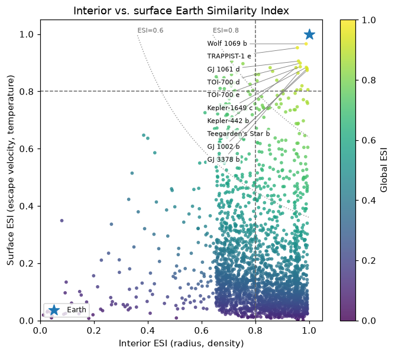
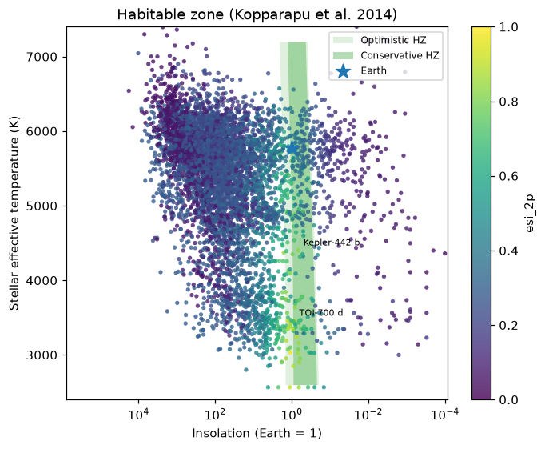
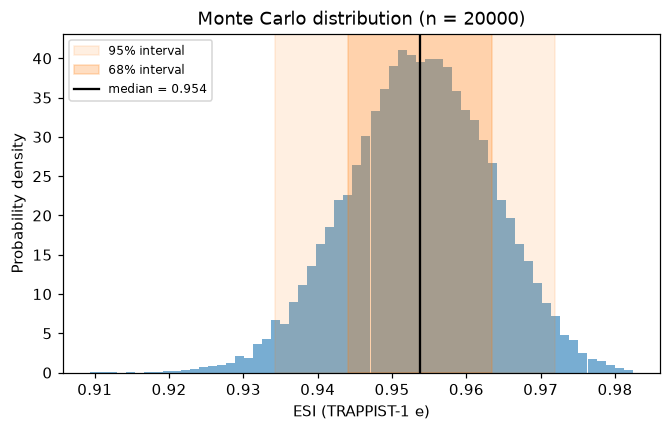

# Plots

Plotting needs `pip install "exohab[viz]"` or `"exohab[all]"`. Every function
returns a matplotlib `Axes` and accepts an `ax=` argument, so you can combine
plots or style them further.

## Interior vs. surface ESI

```python
import exohab as eh

df = eh.load_nasa_exoplanets()
eh.plot_esi_scatter(df[df.pl_rade < 2.5], top_n=10)
```

The dashed lines mark the 0.8 "Earth-like" threshold. Dotted curves are lines
of constant global ESI. The highest-scoring planets are labelled.

{ loading=lazy }

## Habitable-zone diagram

```python
import exohab as eh

df = eh.load_nasa_exoplanets()
eh.plot_habitable_zone(df, color_col="esi_2p", labels=["Kepler-442 b", "TOI-700 d"])
```

Stellar temperature against insolation, with the Kopparapu et al. (2014)
conservative (dark) and optimistic (light) habitable zones.

{ loading=lazy }

## Monte Carlo distribution

```python
import exohab as eh

mc = eh.compute_esi_mc(radius=(0.920, 0.013, -0.012), mass=(0.692, 0.022, -0.022),
                       surface_temp=(283.3, 2.6), n_samples=20_000, seed=42)
eh.plot_mc_distribution(mc, label="ESI (TRAPPIST-1 e)")
```

{ loading=lazy }

Save any plot with `ax.figure.savefig("plot.png", dpi=150)`.
