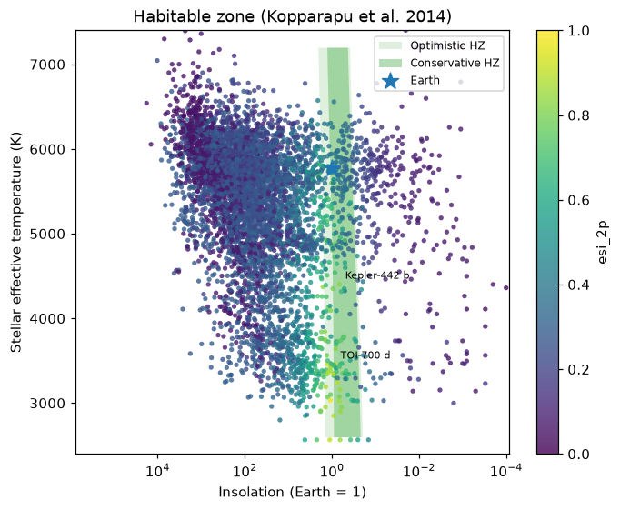
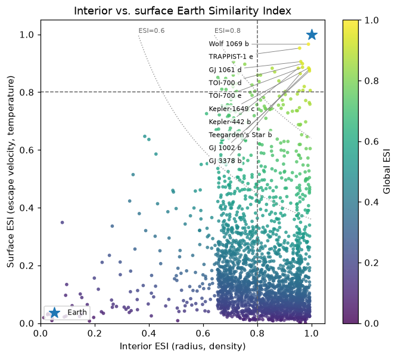

<section class="hx-section" markdown>

<p class="hx-kicker">Everything in one package</p>

## From raw telescope data to scientific insight { .hx-h2 }

<p class="hx-sub">No more copying formulas from papers, downloading stale CSV files or ignoring error bars.</p>

<div class="hx-features" markdown>

<div class="hx-card" markdown>
:material-earth:{ .hx-icon }

### Published metrics

Earth Similarity Index (4- and 2-parameter), Mars, Venus and Titan similarity,
PHI and BCI, implemented exactly as published.

[Explore metrics →](guide/metrics.md)
</div>

<div class="hx-card" markdown>
:material-orbit:{ .hx-icon }

### Habitable zones

Kopparapu et al. (2014) conservative and optimistic boundaries, as fluxes or
orbital distances.

[See the habitable zone →](guide/habitable-zone.md)
</div>

<div class="hx-card" markdown>
:material-dice-multiple:{ .hx-icon }

### Honest uncertainty

Monte Carlo propagation of lopsided error bars, for one planet or the whole
catalogue, with 68% and 95% intervals.

[Model uncertainty →](guide/uncertainty.md)
</div>

<div class="hx-card" markdown>
:material-satellite-variant:{ .hx-icon }

### Live NASA data

Every confirmed planet from the NASA Exoplanet Archive. No API key, and a
local cache for offline work.

[Load the catalogue →](guide/data.md)
</div>

<div class="hx-card" markdown>
:material-robot-outline:{ .hx-icon }

### ML-ready features

A scikit-learn transformer that turns raw catalogue columns into 15
habitability features.

[Build features →](guide/ml.md)
</div>

<div class="hx-card" markdown>
:material-chart-scatter-plot:{ .hx-icon }

### One-line plots

Interior vs. surface ESI, habitable-zone diagrams and Monte Carlo
distributions.

[View plots →](guide/plots.md)
</div>

</div>
</section>

<section class="hx-section hx-section--alt" markdown>

<p class="hx-kicker">How it works</p>

## From install to answers in minutes { .hx-h2 }

<div class="hx-steps" markdown>

<div class="hx-step" markdown>
<span class="hx-step__num">1</span>

### Install

`pip install "exohab[all]"`. It only needs numpy, pandas and requests at its core.
</div>

<div class="hx-step" markdown>
<span class="hx-step__num">2</span>

### Load real data

`load_nasa_exoplanets()` fetches every confirmed planet and adds ESI columns.
</div>

<div class="hx-step" markdown>
<span class="hx-step__num">3</span>

### Get answers with error bars

Monte Carlo turns measurement errors into medians and credible intervals.
</div>

</div>

```python
import exohab as eh

df = eh.load_nasa_exoplanets()                        # 6,000+ confirmed planets
print(df.nlargest(5, "esi_2p")[["pl_name", "esi_2p"]])

mc = eh.compute_esi_2p_mc(radius=(1.34, 0.11, -0.18), flux=(0.66, 0.23, -0.41),
                          n_samples=20_000, seed=42, truncate=True)
print(f"Kepler-442 b: ESI {mc.median:.2f}, 68% range {mc.ci68[0]:.2f}-{mc.ci68[1]:.2f}")
```

</section>

<section class="hx-section" markdown>

<p class="hx-kicker">See it</p>

## Publication-ready plots in one line { .hx-h2 }

<div class="hx-gallery" markdown>

<figure markdown>
{ loading=lazy }
<figcaption>Every confirmed planet against the Kopparapu habitable zone</figcaption>
</figure>

<figure markdown>
{ loading=lazy }
<figcaption>Interior vs. surface ESI, with the top candidates labelled</figcaption>
</figure>

</div>
</section>

<section class="hx-section hx-section--alt" markdown>

<p class="hx-kicker">Built for</p>

## Students, data scientists and researchers { .hx-h2 }

<div class="hx-audience" markdown>

<div class="hx-card" markdown>
:material-school:{ .hx-icon }

### Students & educators

Compare real worlds with Earth in minutes, with clear plots for classes and
outreach.
</div>

<div class="hx-card" markdown>
:material-database-cog:{ .hx-icon }

### Data scientists

Clean DataFrames and engineered habitability features for classification and
clustering.
</div>

<div class="hx-card" markdown>
:material-microscope:{ .hx-icon }

### Researchers

Cited formulas, custom references and weights, and uncertainty-aware results
you can cite.
</div>

</div>
</section>

<section class="hx-section" markdown>

<p class="hx-kicker">Grounded in the literature</p>

## Science you can check { .hx-h2 }

<p class="hx-sub">Every formula is cited in its docstring, and the test suite checks results against published values.</p>

<div class="hx-refs" markdown>
<span>Schulze-Makuch et al. 2011 · *Astrobiology*</span>
<span>Kopparapu et al. 2013, 2014 · *ApJ*</span>
<span>Irwin et al. 2014 · *Challenges*</span>
<span>Kashyap Jagadeesh 2017</span>
<span>Planetary Habitability Laboratory</span>
<span>NASA Exoplanet Archive</span>
</div>

[Read the science & methods →](science.md){ .hx-link }

</section>

<section class="hx-section hx-section--alt" markdown>

<p class="hx-kicker">FAQ</p>

## Frequently asked questions { .hx-h2 }

??? question "What is the Earth Similarity Index (ESI)?"
    The Earth Similarity Index is a number from 0 to 1 that measures how
    similar a planet's radius, bulk density, escape velocity and surface
    temperature are to Earth's (Schulze-Makuch et al. 2011). A two-parameter
    version uses radius and stellar flux. It measures similarity, **not** the
    probability of life.

??? question "Is exohab free?"
    Yes. exohab is open source under the MIT license and can be used freely in
    research, teaching and commercial projects.

??? question "Do I need an API key for NASA data?"
    No. exohab loads the NASA Exoplanet Archive through its public TAP service,
    which needs no API key, and caches the data locally for offline use.

??? question "How do I install exohab?"
    Run `pip install exohab`, or `pip install "exohab[all]"` to include
    plotting and machine-learning features. Python 3.10 or newer is required.

??? question "How can I cite exohab?"
    Each release is archived on Zenodo with a DOI. Cite the project as
    [10.5281/zenodo.24269967](https://doi.org/10.5281/zenodo.24269967), and
    also cite the original papers of the metrics you use. See
    [Citing exohab](citing.md).

</section>

<section class="hx-final" markdown>

## Start exploring other worlds { .hx-h2 }

<p class="hx-sub">Free and open source, and installed in seconds.</p>

[Get started](quickstart.md){ .md-button .md-button--primary .hx-btn }
[Read the docs](guide/metrics.md){ .md-button .hx-btn }

</section>
